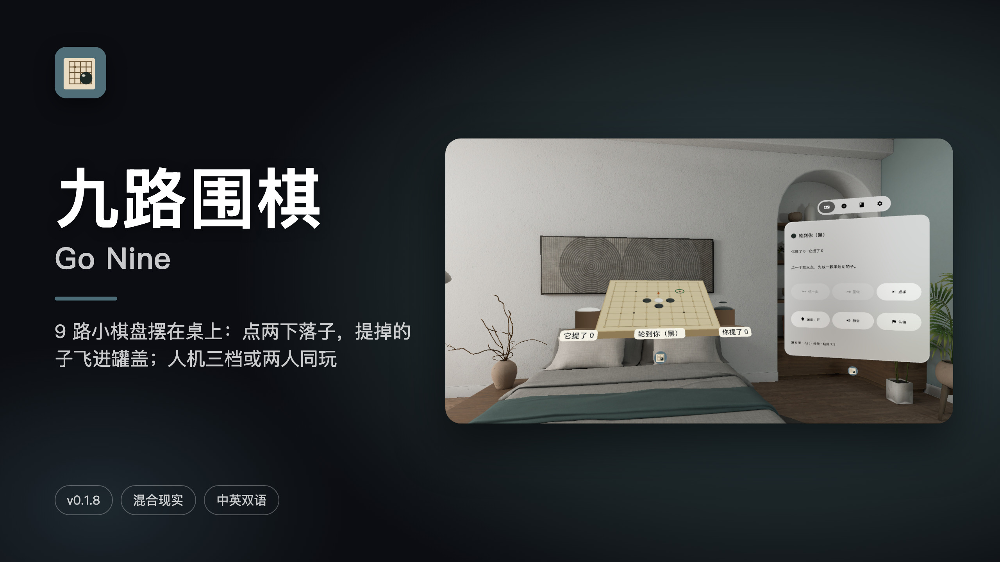
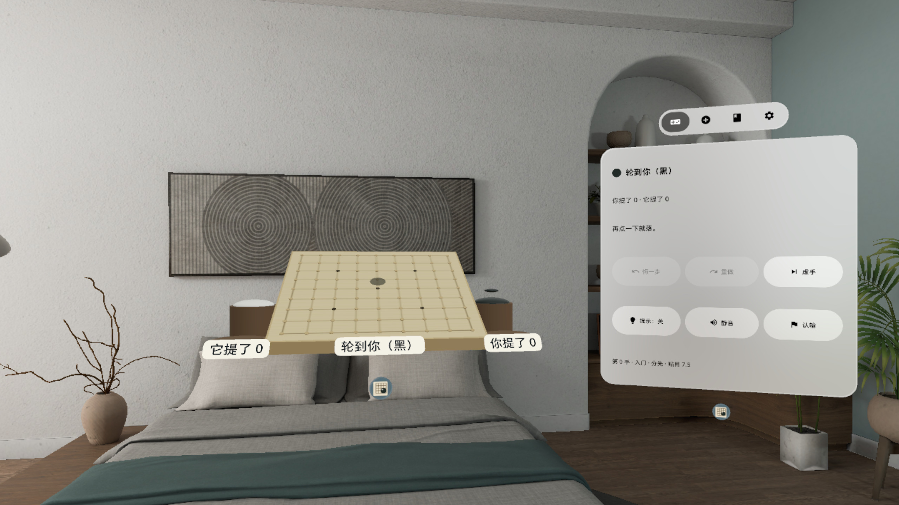
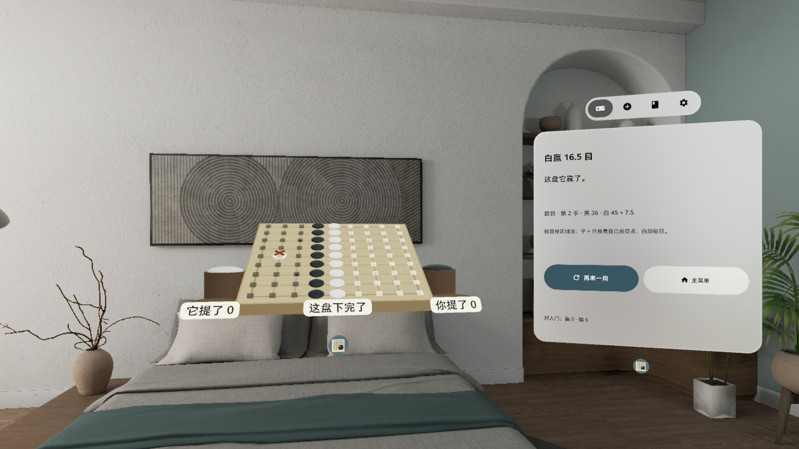
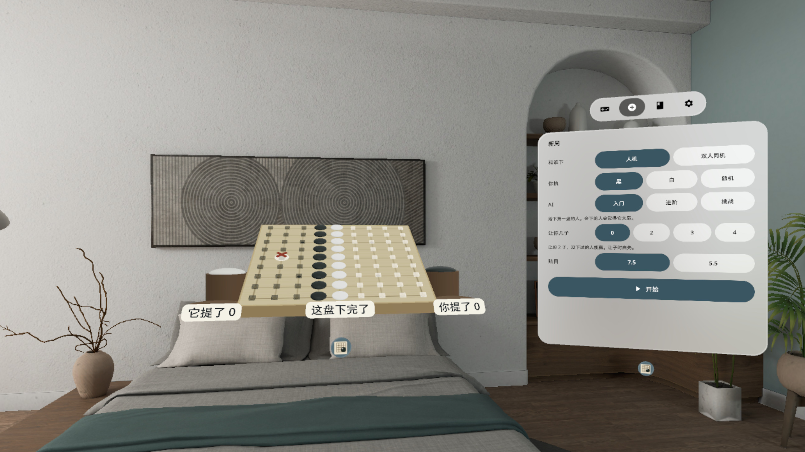
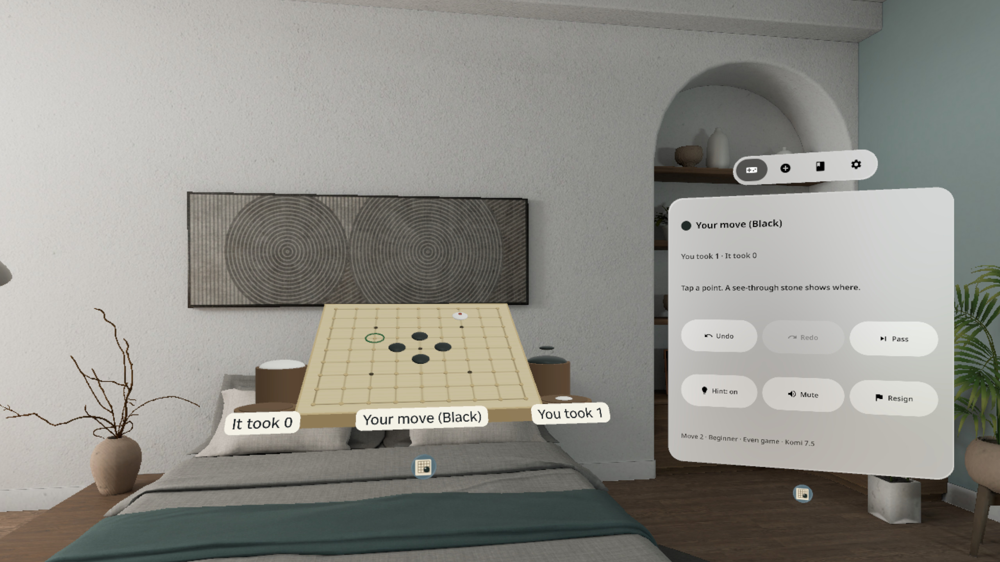
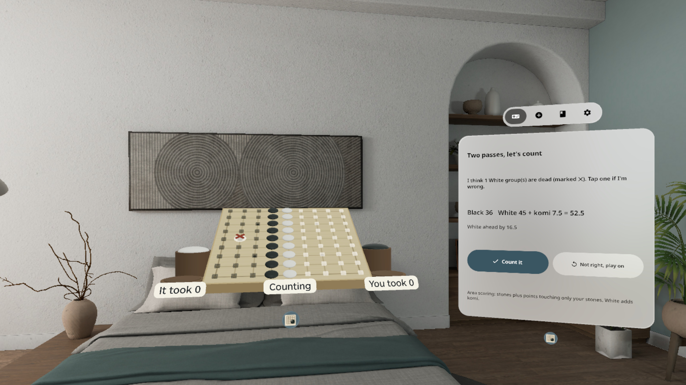
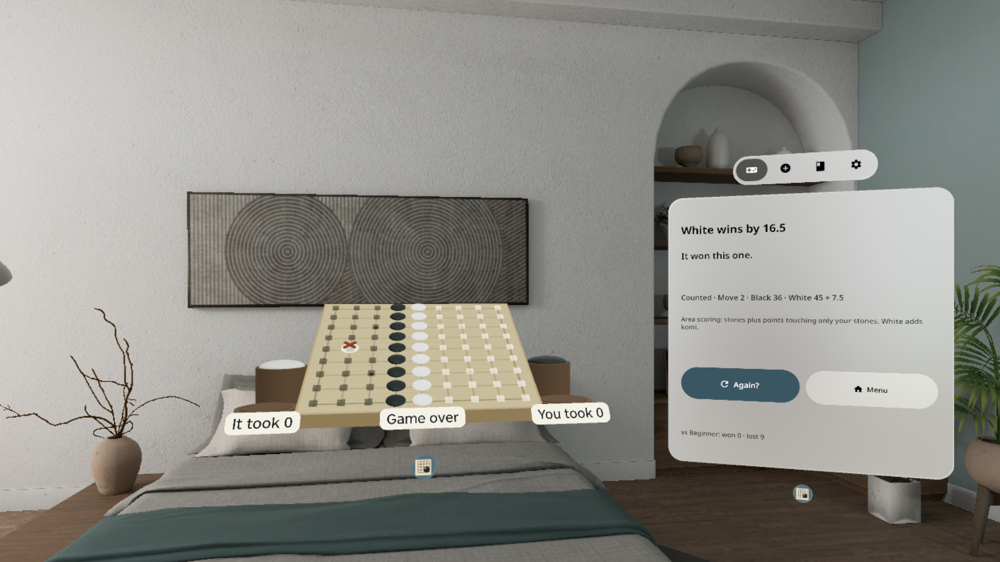
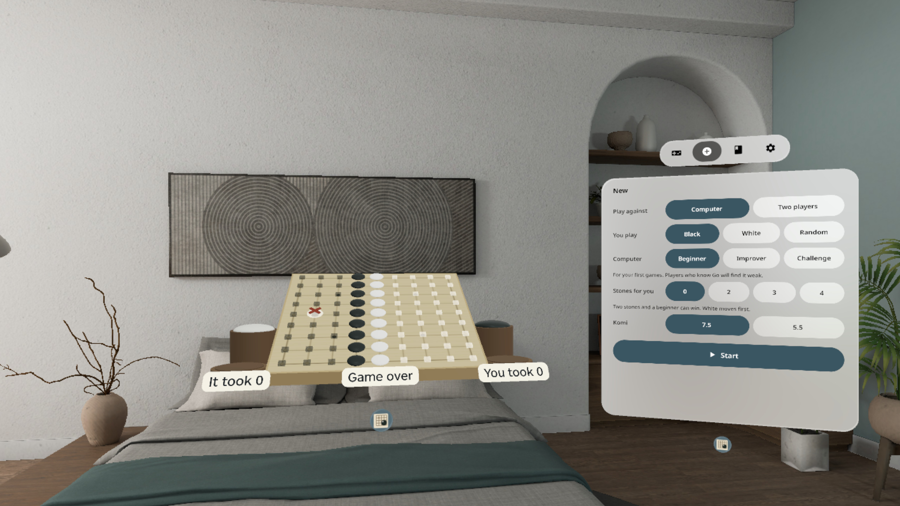

# 九路围棋 Go Nine



[中文](#中文) · [English](#english)

---

## 中文

**9 路小棋盘摆在桌上：点两下落子，提掉的子飞进罐盖；人机三档或两人同玩。**

PICO 空间应用（PICO OS 6 · Spatial SDK · Shared Space 立体窗口 + 控制窗）。一张 9 路小棋盘和两罐云子摆在你面前：点一个交叉点，先放一颗半透明的子，再点一下落定；围住对方没气了，那几颗子就提起来飞进你的罐盖，罐盖里的子就是提子数。两边都虚手就数目，确认死子后出结果。

### 能做什么

- **两下落子**：第一下放一颗半透明的幽灵子，非法点（自杀、劫、已有子）当场标红 ✕；再点一下才落定，手抖不会误下
- **提子进罐盖**：被提的子沿弧线飞进对方罐盖，棋盘两侧小牌实时显示「你提了 / 它提了」
- **提示**：打开后显示每块棋的气（立体光点）和打吃提醒环，适合刚学的人
- **对手**：电脑三档（入门 / 进阶 / 挑战，本机 MCTS，入门档输给你很正常），或两人同机轮流下；让子 0–4、贴目 7.5 / 5.5
- **数目**：两边虚手后自动数（数子法），死子打 ✕，点一下可以改；确认后出结果卡
- **控制窗四页**：对局（悔一步 / 重做 / 虚手 / 认输 / 提示 / 静音）· 新局 · 规则（气、提子、劫、虚手数目 + 新手常错）· 设置（语言、音量、减少动态、棋盘倾角 0° / 15° / 25°、重开控制窗、退出应用）
- 手柄射线、手势射线、眼手（注视 + 捏合）都能点；交叉点有小圆点承接系统高亮；中英双语；本机运行，不联网、不要账号

### 截图

> v0.1.8 截图和演示视频来自 PICO 模拟器 6.1，由调试广播驱动，**非真实手势录像**。演示视频 `video-01.mp4`（60 s，无声）在 Release 资产里。

| | |
|---|---|
|  提示打开：气的光点和打吃环，对方一颗白子只剩一口气 |  提子：白子被提起，飞向你的罐盖，「你提了 1」 |
|  第一下：半透明幽灵子落在天元，再点一下才落定 |  两边虚手后数目：死子打 ✕，控制窗列出黑白目数 |
|  结果卡：谁赢几目、提子数，再来一局 / 主菜单 |  新局：人机 / 双人、执黑白、三档 AI、让子、贴目 |

英文界面截图：`docs/shot-en-01.jpg` … `docs/shot-en-06.jpg`，英文海报 `docs/poster-en.jpg`。

### 安装

[Release v0.1.8](https://github.com/kejing-dev/GoNine/releases/tag/v0.1.8) 里的 `GoNine-v0.1.8.apk` 是未签名的 release 包（给应用商店上架用，平台重签名，不能直接 `adb install`）。自己装请从源码构建 debug 包，头显开启开发者模式并用 USB 连上电脑：

```bash
./gradlew assembleDebug
adb install -r app/build/outputs/apk/debug/app-debug.apk
pico-cli app launch io.embodit.gonine
```

需要 PICO OS 6（Android 15，minSdk 35）。不申请任何权限。

### 已知问题

1. 模拟器 QA 第 6 轮测的是 v0.1.7（过）；v0.1.8 是真机反馈修复（落子换真实围棋石子落木盘录音、预选 / 取子 / 指着交叉点不出声、提示音调小、交叉点加小圆点承接系统高亮），用户在头显上看过放行，没再跑完整一轮模拟器 QA。
2. 新局设置页在没有进行中的对局时，控制窗空白约 26–31%；双人同机时约 40%（v0.1.3 起就有）。
3. 三种输入（手柄射线、手势射线、眼手）由用户在头显上验过。

### 版本历史

- **v0.1.8**（真机反馈）：落子换成真实围棋石子落木盘的「啪」（6 段轮换），预选 / 取子 / hover 无声，UI 提示调小；每个交叉点加一个小圆点，系统高亮画在它上面
- **v0.1.7**：新局确认页撑满窗口（QA #5 打回项，空白 37% → 6–8%）
- **v0.1.6**：柔和的界面提示音；垫片和棋子承载系统 hover 高亮
- **v0.1.5**：实物声换成 CC0 录音；棋盘输入模板 + hover 提示
- **v0.1.4**：英文小牌字高 ≥ 18 mm
- **v0.1.3**：重开控制窗的位置、小牌字号、短页面撑开、滑条 48 dp
- **v0.1.2**：退出不留残留、[重开控制窗] 文案、英文 TabBar、退出图标
- **v0.1.1**：响度、窗口加高、虚手策略、死子标记、倾斜转轴
- **v0.1.0**：首个版本，完整九路 + 三档 AI

### 许可与素材

- 落子 / 提子：freesound CC0 1.0 围棋石子录音（Hongsungbock「baduk2」、billhails2「GoStoneSounds」）；界面提示音：Kenney interface-sounds（CC0，见 `third_party/kenney/`）
- 图标：Material Symbols（Apache-2.0）；字体：Noto Sans（SIL OFL）
- 本仓库公开；用 Claude Code 在「黑灯工厂」产线上研发（Claude Opus 5.5 研发 / QA / 发布，Claude Fable 5.1 调研 / 设计）

---

## English

**A 9x9 Go board on your table: tap twice to play, captures drop into the lid; three AI levels or two players.**

A PICO spatial app (PICO OS 6 · Spatial SDK · Shared Space volume + control window). A small 9x9 board and two bowls of stones sit in front of you: tap a point to drop a see-through stone, tap again to place it. Surround a group until it has no liberties and its stones lift off and arc into your bowl lid — the lid is your capture count. When both sides pass, the board is counted; confirm the dead stones and you get the result.

### Features

- **Two-tap moves**: the first tap shows a see-through ghost stone and marks illegal points (suicide, ko, occupied) with a red ✕ right away; the second tap places it, so a shaky hand never misplays
- **Captures into the lid**: captured stones arc into the lid; the cards beside the board show "You took / It took" live
- **Hints**: shows each group's liberties as 3D lights plus an atari ring — made for beginners
- **Opponents**: three computer levels (Beginner / Improver / Challenge, on-device MCTS; Beginner is happy to lose) or two players on one headset; handicap 0–4, komi 7.5 / 5.5
- **Counting**: after two passes the board is area-scored, dead stones get an ✕ and can be toggled; confirm to see the result card
- **Four-page control window**: Play (undo / redo / pass / resign / hint / mute) · New · Rules (liberties, capture, ko, pass and count + easy mistakes) · Settings (language, volume, reduced motion, board tilt 0° / 15° / 25°, reopen panel, quit app)
- Works with controller ray, hand ray and eye-hand (gaze + pinch); each point has a small dot that carries the system hover highlight; Chinese / English; fully offline, no account

### Screenshots

> v0.1.8 screenshots and the demo video were captured on the PICO 6.1 emulator, driven by debug broadcasts — **not a real hand-gesture recording**. The demo video `video-01.mp4` (60 s, silent) is a Release asset.

| | |
|---|---|
|  Hints on: liberty lights and an atari ring around a white stone with one liberty left |  Capture: the white stone lifts off toward your lid — "You took 1" |
|  First tap: a see-through ghost stone on the center point; tap again to place |  Counting after two passes: dead stones marked ✕, totals in the control window |
|  Result card: who won by how much, captures, Again / Menu |  New game: computer or two players, color, three AI levels, handicap, komi |

### Install

`GoNine-v0.1.8.apk` in [Release v0.1.8](https://github.com/kejing-dev/GoNine/releases/tag/v0.1.8) is an unsigned release build (for store submission, re-signed by the platform; it cannot be `adb install`ed directly). To install it yourself, build the debug APK with the headset in developer mode and connected over USB:

```bash
./gradlew assembleDebug
adb install -r app/build/outputs/apk/debug/app-debug.apk
pico-cli app launch io.embodit.gonine
```

Requires PICO OS 6 (Android 15, minSdk 35). No permissions requested.

### Known issues

1. Emulator QA round 6 passed on v0.1.7; v0.1.8 is a headset-feedback fix (real Go-stone-on-wood recordings, silent pre-selection / pick-up / hover, quieter UI cues, a small dot on every point to carry the system highlight), approved by the user on the headset without another full emulator QA round.
2. The New game page leaves about 26–31% of the control window blank when no game is in progress, about 40% in two-player mode (since v0.1.3).
3. All three inputs (controller ray, hand ray, eye-hand) were checked by the user on the headset.

### Credits

- Stone sounds: freesound CC0 1.0 Go stone recordings (Hongsungbock "baduk2", billhails2 "GoStoneSounds"); UI cues: Kenney interface-sounds (CC0, see `third_party/kenney/`)
- Icons: Material Symbols (Apache-2.0); font: Noto Sans (SIL OFL)
- Built with Claude Code on the "dark factory" pipeline (Claude Opus 5.5 build / QA / release, Claude Fable 5.1 research / design)
